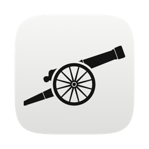
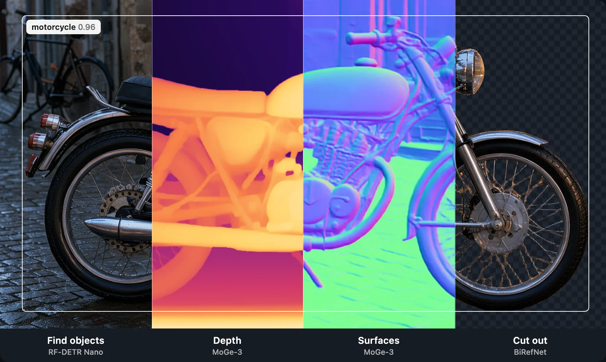
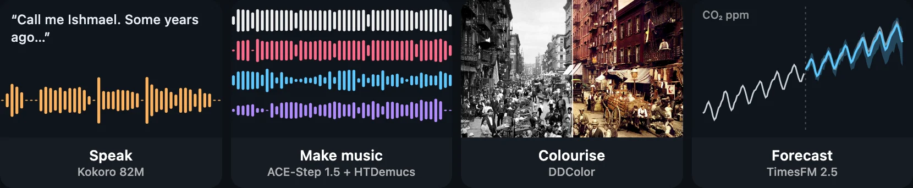
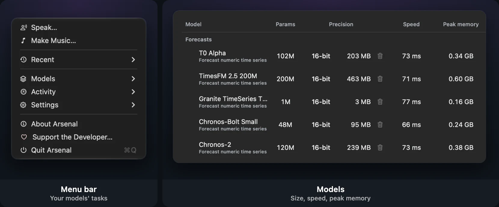

<p align="center">
  
</p>

<h1 align="center">Arsenal</h1>

<p align="center">103 open AI models on your Mac, for you and your agents.</p>

<p align="center">
  <a href="https://github.com/TobyNoSkillSon/Arsenal/releases/latest"></a>
  &nbsp;
  <a href="https://tobynoskillson.com/arsenal"></a>
  &nbsp;
  <a href="https://tobynoskillson.com/#support"></a>
</p>

<p align="center"><a href="docs/MODELS.md">Models</a> · <a href="https://github.com/TobyNoSkillSon/Arsenal/releases/latest">Latest release</a> · <a href="#connect-an-agent-over-mcp">MCP</a> · <a href="LICENSE">MIT licence</a></p>

<a name="install"></a>Use them from the menu bar, or let Claude Code and Codex call them over MCP. Everything runs on device, on a Mac with Apple silicon and macOS 26 or newer.

```sh
brew install --cask tobynoskillson/tap/arsenal
```

<details>
<summary><b>Other ways to install</b></summary>

Use the installer script, which downloads the latest release, checks its SHA-256 and signature, installs `~/Applications/Arsenal.app`, links `~/.local/bin/arsenal-mcp` and starts the app (quit Arsenal first when updating this way):

```sh
curl -fsSL \
  https://raw.githubusercontent.com/TobyNoSkillSon/Arsenal/main/scripts/install.sh \
  | bash
```

Or by hand: download `Arsenal-<version>-arm64.zip` and `SHA256SUMS` from [GitHub Releases](https://github.com/TobyNoSkillSon/Arsenal/releases), check it, then unzip it and move `Arsenal.app` to `~/Applications` or `/Applications`:

```sh
shasum -a 256 -c SHA256SUMS \
  --ignore-missing
```

Arsenal is signed with its own self-signed certificate, Arsenal Release Signing. It is not notarised by Apple. The cask and the installer clear the download quarantine flag, so the app opens normally. After a manual download macOS blocks the first launch; clear the flag once with

```sh
xattr -dr com.apple.quarantine \
  ~/Applications/Arsenal.app
```

or open it anyway from System Settings → Privacy & Security.

</details>

<p>
<picture>
  <source media="(max-width: 600px)" srcset="docs/images/readme-hero-phone.webp">
  
</picture>
</p>

<p>
<picture>
  <source media="(max-width: 600px)" srcset="docs/images/readme-more-phone.webp">
  
</picture>
</p>

The catalog holds 103 models: transcription and who spoke when, voices, document reading, translation, images, video, 3D, music, sound cleanup, detection, search and more. Each downloads on its own, from under 1 MB to 28.5 GB; all of them together take 374 GB. [docs/MODELS.md](docs/MODELS.md) lists each with its download size, weights licence, what it is good for and its limits. No chat model ships by default; you can add your own.

## First run

<p>
<picture>
  <source media="(max-width: 600px)" srcset="docs/images/readme-app-phone.webp">
  
</picture>
</p>

Arsenal lives in the menu bar; it has no Dock icon or main window, and Launch at Login is on from the first launch. **Models** opens your table, which starts empty. **Get more models** opens the catalog browser: **Add** puts a model on your table and **Get** shows its download size and fetches the weights. Turn on a model's **Show in menu** and its tasks join the top of the menu: **Speak…**, **Make Music…**, **Make an Image…**, **Transcribe…** and so on, each opening its window with the model as a choice inside. A model loads when you first use it. Weights and settings live in `~/Library/Application Support/Arsenal`.

## Connect an agent over MCP

The app serves MCP while it runs. Stdio clients use the bundled bridge, which finds the app and its access token on its own:

```sh
claude mcp add arsenal -- arsenal-mcp
codex mcp add arsenal -- arsenal-mcp
```

The cask and the installer put `arsenal-mcp` on your path; otherwise use the copy inside the app, `Contents/Helpers/arsenal-mcp` in `Arsenal.app` (in `/Applications` or `~/Applications`). The HTTP endpoint, its bearer token and the fifteen tools are in [docs/MCP.md](docs/MCP.md); the agent skill is [skill/SKILL.md](skill/SKILL.md), and scripts can use the [HTTP API](docs/API.md).

## Updates, uninstall and building

<details>
<summary><b>Updates</b></summary>

Arsenal checks GitHub Releases about every three days. A new version shows as an orange **Update to …** item in the menu; it installs when nothing is generating, keeps the previous app as `Arsenal.app.previous`, and reloads the models you had loaded. It installs only a release signed with the same certificate. Models and settings stay. Homebrew leaves updates to the app. Details: [docs/UPDATES.md](docs/UPDATES.md).

</details>

<details>
<summary><b>Uninstall</b></summary>

Turn off **Launch at Login** in Arsenal's Settings, then quit Arsenal from its menu (otherwise macOS keeps a login-item entry; remove it in System Settings → General → Login Items). With Homebrew, `brew uninstall --cask arsenal`; add `--zap` to also delete downloaded models and settings. Otherwise delete `Arsenal.app` (and `Arsenal.app.previous` beside it), `~/.local/bin/arsenal-mcp`, and, to remove models and settings, `~/Library/Application Support/Arsenal`, `~/Library/Caches/Arsenal`, `~/Library/Caches/dev.arsenal.app`, `~/Library/HTTPStorages/dev.arsenal.app` and `~/Library/Preferences/dev.arsenal.app.plist`.

</details>

<details>
<summary><b>Build from source</b></summary>

You need an Apple silicon Mac, Xcode 27 (its Metal compiler) and the Command Line Tools with Swift 6.4, and SwiftLint 0.65.1 (`brew install swiftlint`).

- `scripts/check.sh`: lint, build and the suites your change affects (day loop)
- `scripts/test.sh`: lint and the default test suites; no model inference
- `scripts/ready.sh`: every suite, then the signed candidate in `dist/` (needs the signing identity)
- `scripts/test.sh --heavy`: GPU model tests, opt-in

`scripts/build.sh` assembles and signs `dist/Arsenal.app`. Release builds use the Arsenal Release Signing key, which only the release workflow holds. To build your own copy, sign with a code-signing certificate of yours (its SHA-1 in `CERT_SHA1`) and leave out the update feed (such a build neither takes nor gives updates):

```sh
ARSENAL_ALLOW_OTHER_IDENTITY=1 \
ARSENAL_SIGN_IDENTITY="$CERT_SHA1" \
ARSENAL_UPDATE_REPO= \
scripts/build.sh
```

Code lives in `Sources/` (app, services, commands), native engines in `Workers/`, model recipes in `models/`, and the signed catalog and schemas in `Resources/`. See [docs/README.md](docs/README.md) and [Contributing](docs/CONTRIBUTING.md); a new model is a folder, described in [Adding a model](docs/ADDING-A-MODEL.md).

</details>

## Feedback

Bugs, complaints and ideas go to [Issues](https://github.com/TobyNoSkillSon/Arsenal/issues); even a short note helps. Fixes are welcome as pull requests.

## Licence

Arsenal's code is MIT ([LICENSE](LICENSE)); third-party code keeps its own licence ([NOTICE](NOTICE)). Each model's weights have their own licence, shown in the app's catalog with any conditions before you download, and linked from [docs/MODELS.md](docs/MODELS.md). Most are Apache 2.0, MIT, BSD or CC BY. Some come with conditions:

<details>
<summary><b>Weights with conditions, and gated models</b></summary>

- Commercial use only below a revenue threshold or with further terms: d1 · 3B (LFM Open License v1.0, under US$10 million a year), FLUX 3 Image Klein (FLUX Kommunity License: non-commercial, commercial outputs for qualifying users under US$5 million), Stable Audio 3 Medium and Small SFX (Stability AI Community License: under US$1 million, after registering), Fish Audio Drama 3 (Fish Audio Community License: under US$500,000, no hosted service, show "Built with Fish Audio"), Chandra OCR 2 (modified OpenRAIL-M: under US$2 million in funding or revenue, not competing with Datalab's API), Timestral 209M (Mistral's modified MIT: not for companies above US$20 million a month) and MiniMax Music 3 (MiniMax-Music3 Community License: name it in a commercial product, written authorisation above US$20 million a year).
- Non-commercial only: DiariZen Large v2 and YuE2 3B (CC BY-NC 4.0) and GIMM-VFI-R (S-Lab License 1.0).
- Meta's terms: SAM 3.1 and SAM Audio Large (SAM License) and the DINOv3 image encoder that TRELLIS.2 4B and IDOL download (DINOv3 License); no trade-controlled uses, and redistributed copies keep the licence.
- EmbeddingGemma 2 is Apache 2.0 under Google's Gemma Prohibited Use Policy.

FLUX 3 Image Klein, SAM 3.1, SAM Audio Large, TRELLIS.2 4B and IDOL are gated: accept the maker's terms on the model's Hugging Face page (Meta approves each request by hand), add a Hugging Face read token in Settings, and Arsenal downloads with it.

</details>
